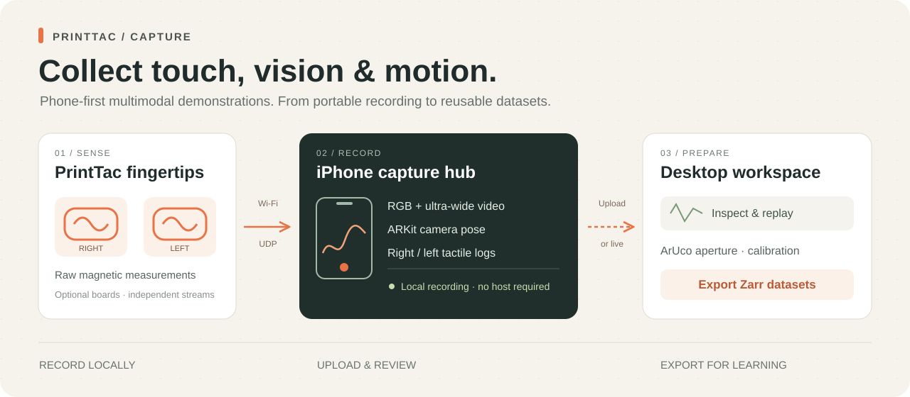

<div align="center">



# PrintTac Capture

**Untethered multimodal demonstration collection with an iPhone.**

Record vision, motion and tactile observations locally. Upload, replay and prepare datasets for robot learning.

[](docs/INSTALL_IPHONE_APP.md) [](docs/SETUP.md) [](docs/ZARR_EXPORT.md) [](LICENSE)

[Project page](https://peppasaur.github.io/PrintTac/) · [简体中文](README.zh-CN.md) · [Quick start](#quick-start) · [Documentation](#documentation)

</div>

## What this repository provides

PrintTac Capture is the data-collection software for the PrintTac portable demonstration workflow. A handheld UMI-style gripper combines an iPhone with optional PrintTac fingertips. The phone records camera video, ARKit camera pose and right/left magnetic sensor streams; a desktop workspace handles uploads, inspection, replay, gripper-aperture processing and Zarr export.

**The iPhone is the recording hub.** A computer can monitor a live session, but demonstrations can be recorded without a host connection and uploaded afterward.

| Capture on the phone | Review on the desktop | Prepare for learning |
| --- | --- | --- |
| RGB and supported ultra-wide video | Grouped experiment uploads | ArUco gripper-aperture processing |
| ARKit pose and recording timestamps | Video, pose and tactile replay | Optional camera-to-gripper calibration |
| Independent right/left magnetic logs | Stream and transport diagnostics | Aligned Zarr episode export |

The [PrintTac project page](https://peppasaur.github.io/PrintTac/) introduces the tactile hardware and research results. This repository implements the capture and dataset-preparation workflow; hardware CAD, sensor firmware, force-estimation models and policy training/deployment are separate components.

## Quick start

### 1. Prepare the phone

Build and sign the iOS app on a Mac using Xcode and XcodeGen. Follow the [iPhone installation guide](docs/INSTALL_IPHONE_APP.md). The existing Xcode target remains `ARPoseStreamer`.

For tactile collection, connect the configured right/left sensor boards to the iPhone hotspot. Configure and check each board using the [magnetic capture guide](docs/HOTSPOT_MAGNETIC_CAPTURE.zh-CN.md). Pose/video recording also works with no magnetic boards connected.

### 2. Open the desktop workspace

Install dependencies from the repository root using Python 3.10 or newer:

```bash
python -m pip install -r requirements_visualizer.txt
python arpose.py monitor --phone-ip 172.20.10.1
```

`172.20.10.1` is the usual iPhone hotspot address. On a regular LAN, use the phone's actual IP. On macOS, use `python3`.

### 3. Record, upload and replay

1. On the phone, use **Start Experiment** to begin local recording.
2. Use **Stop & Save Experiment** to finalize the capture.
3. Transfer saved captures through **Past Records → Upload Data** with the desktop receiver running.
4. Select an experiment in the desktop workspace to inspect video, pose and available tactile streams.

Source runs store experiments in `uploads/` at the repository root. Packaged desktop tools store them in `uploads/` beside the executable. A typical dual-board capture contains:

```text
uploads/<experiment>/
├── video.mp4
├── ultrawide_video.mp4          # when recorded on a supported device
├── pose.csv
├── magnetic_right.csv          # when right-board samples are present
├── magnetic_left.csv           # when left-board samples are present
└── capture_manifest.json
```

### 4. Export a dataset

```bash
python arpose.py export-zarr --capture "uploads/<experiment>" --out "dataset.zarr"
```

See the [export guide](docs/ZARR_EXPORT.md) for calibration, field definitions and action targets. Raw ARKit pose is a camera trajectory; applying it as a gripper/robot pose requires the appropriate calibration. Raw magnetic measurements are tactile observations, rather than calibrated force/torque values. Exported next-observation action targets are derived from demonstrations.

## Choose a tool

The shared entry point is `python arpose.py <tool>`. Use `--help` to inspect a tool's options, and run one listener per UDP port.

| Goal | Command |
| --- | --- |
| Live experiments, uploads and replay | `python arpose.py monitor` |
| View only the 3D pose trajectory | `python arpose.py visualizer` |
| Receive pose in a terminal | `python arpose.py receiver` |
| Run only the HTTP upload server | `python arpose.py upload-server` |
| Receive combined pose and tactile packets | `python arpose.py magnetic-receiver` |
| Inspect video / packet loss | `python arpose.py video-debugger` / `packet-loss` |
| Validate a recorded trajectory | `python arpose.py validator` |
| Open the Zarr export window | `python arpose.py zarr-exporter` |
| Configure serial sensors / track gripper aperture | `python arpose.py anyskin-serial` / `aruco-tracker` |

```bash
python arpose.py --help
python arpose.py monitor --help
```

## Repository map

```text
printtac-capture/
├── arpose.py                   # shared desktop launcher
├── ios/                        # iPhone capture app and resources
├── desktop/                    # reception, replay and dataset processing
├── config/                     # sensor/camera/gripper calibration
├── scripts/                    # platform launchers and executable builds
├── tests/                      # automated regression tests
├── docs/                       # setup, protocols and workflow guides
├── project.yml                 # XcodeGen project definition
└── requirements_visualizer.txt # desktop dependencies
```

Detailed module responsibilities are listed in the [module map](docs/REPOSITORY_LAYOUT.zh-CN.md).

## Documentation

| Start here | Reference |
| --- | --- |
| [iPhone installation](docs/INSTALL_IPHONE_APP.md) | [Architecture](docs/ARCHITECTURE.md) |
| [Network and sensor setup](docs/SETUP.md) | [Packet and recording protocols](docs/PROTOCOL.md) |
| [Magnetic capture](docs/HOTSPOT_MAGNETIC_CAPTURE.zh-CN.md) | [ArUco gripper integration](docs/ARUCO_GRIPPER_INTEGRATION.zh-CN.md) |
| [Zarr export](docs/ZARR_EXPORT.md) | [Calibration](docs/CALIBRATION_OVERVIEW.en.md) |
| [Detailed usage](docs/USAGE.md) | [Desktop executable builds](docs/BUILD.md) |

## Development

```bash
python -m unittest discover -s tests -t .
```

On a Mac, generate the iPhone project with `xcodegen generate` from the repository root. Build desktop executables with `.\scripts\build_windows.ps1` on Windows or `bash scripts/build_macos.sh` on macOS. See [contributing](CONTRIBUTING.md) for development guidance.

## License

[MIT](LICENSE).
