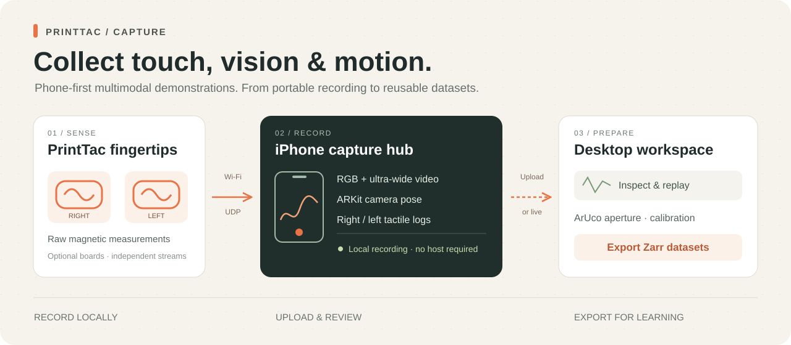

<div align="center">



# PrintTac Capture

**以 iPhone 为中心的无线多模态示教采集工具。**

手机本地记录视觉、位姿与触觉，电脑负责上传、回放和机器人学习数据集准备。

[](docs/INSTALL_IPHONE_APP.md) [](docs/SETUP.md) [](docs/ZARR_EXPORT.md) [](LICENSE)

[项目主页](https://peppasaur.github.io/PrintTac/) · [English](README.md) · [快速开始](#快速开始) · [文档导航](#文档导航)

</div>

## 项目定位

PrintTac Capture 是 PrintTac 便携示教系统的数据采集软件。手持 UMI 风格夹爪结合 iPhone 和可选的 PrintTac 指尖，由手机记录相机视频、ARKit 相机位姿、左右两路磁传感器数据；电脑端负责接收上传、检查、回放、夹爪开合处理和 Zarr 导出。

**手机是采集中心。** 电脑可以实时监控，也可以等手机独立完成录制后再接收数据。

| 手机端采集 | 电脑端检查 | 数据集准备 |
| --- | --- | --- |
| RGB 与受支持的超广角视频 | 按实验接收上传 | ArUco 夹爪开合处理 |
| ARKit 位姿与录制时间戳 | 视频、位姿和触觉回放 | 可选的相机到夹爪标定 |
| 左右独立磁传感器日志 | 视频与网络传输诊断 | 对齐后导出 Zarr episode |

[PrintTac 项目主页](https://peppasaur.github.io/PrintTac/)介绍触觉硬件与研究结果。本仓库对应采集与数据准备环节；硬件 CAD、传感器固件、力估计模型和策略训练、部署属于其他组件。

## 快速开始

Windows 可直接运行[当前发布版](https://github.com/pigwu/printtac-capture/releases/latest)中的 **PrintTac-Capture.exe**，用于监控、上传与回放，无需安装 Python。请放在可写目录，已有 `uploads/` 保留在 EXE 旁。下面是手机 App 构建与电脑端源码运行步骤。

### 1. 准备手机 App

手机已安装 App 时可跳过构建。否则在 Mac 上使用 Xcode 和 XcodeGen 构建并签名，按[iPhone 安装说明](docs/INSTALL_IPHONE_APP.md)操作。工程、target 和 scheme 均为 `PrintTacCapture`，手机桌面显示名为 PrintTac Capture。**Xcode 用于构建手机 App；Windows 电脑端不需要 Xcode。**

采集触觉时，将配置好的左右传感器板连接到 iPhone 热点，按[磁传感器采集说明](docs/HOTSPOT_MAGNETIC_CAPTURE.zh-CN.md)逐路检查。未连接磁传感器时也可以采集位姿和视频。

### 2. 打开电脑端工作台

源码安装统一使用 **64 位 Python 3.12**。下载并解压仓库（或使用 Git 克隆），在包含 `printtac.py` 的文件夹打开终端。请勿将依赖混装到已有 Conda 或系统环境中。安装脚本会创建项目独立的 `.venv`，安装固定版本的依赖，并检查视频解码、ArUco、绘图和 Zarr 读写。下载中断后可以重复执行。

**Windows 10/11，x64 — PowerShell：**

先从 [Python 3.12 安装包页面](https://www.python.org/downloads/release/python-31210/)的 **Files** 中选择 **Windows installer (64-bit)**（不要下载源码压缩包），保留 Python launcher 选项，安装后重新打开 PowerShell。已有更新的 3.12 补丁版本也可以使用。执行 `py -3.12 --version` 应显示 `Python 3.12.x`。

```powershell
# 首次安装：在解压后的仓库目录运行
py -3.12 scripts/setup_desktop.py

# 安装显示 [READY] 后启动；以后打开软件也使用这一条命令
.\.venv\Scripts\python.exe printtac.py monitor --phone-ip 172.20.10.1
```

**macOS — 终端：**

从 [Python 3.12 安装包页面](https://www.python.org/downloads/release/python-31210/)的 **Files** 中选择 **macOS 64-bit universal2 installer**，或使用已有的 Python 3.12，然后运行：

```bash
python3.12 scripts/setup_desktop.py
./.venv/bin/python printtac.py monitor --phone-ip 172.20.10.1
```

无需激活环境、管理员终端或安装 C/C++ 编译器。后续运行务必使用 `.venv` 中的 Python，单独使用 `python`、`python3` 或 `py` 可能切换到其他环境。`scripts/` 内的平台启动脚本也已统一使用 `.venv`。

`172.20.10.1` 是常见的 iPhone 热点地址；普通局域网下使用手机实际 IP。未连接手机时也可以打开电脑端窗口。遇到下载失败、Python 版本错误，或需要检查 Qt 窗口时，见[电脑端安装与故障排查](docs/INSTALL_DESKTOP.md)。

### 3. 录制、上传和回放

1. 在手机上点击 **Start Experiment** 开始本地录制。
2. 点击 **Stop & Save Experiment** 完成保存。
3. 保持电脑接收端运行，通过 **Past Records → Upload Data** 上传已保存的数据。
4. 在电脑端选择实验，检查视频、位姿和已记录的触觉信号。

源码运行时，实验保存在仓库根目录的 `uploads/`；独立程序保存在其可执行文件旁的 `uploads/`。双路采集的典型文件如下：

```text
uploads/<实验>/
├── video.mp4
├── ultrawide_video.mp4          # 支持的设备且实际录制时存在
├── pose.csv
├── magnetic_right.csv          # 收到右侧样本时存在
├── magnetic_left.csv           # 收到左侧样本时存在
└── capture_manifest.json
```

### 4. 导出数据集

```powershell
.\.venv\Scripts\python.exe printtac.py export-zarr --capture "uploads/<实验>" --out "dataset.zarr"
```

macOS 将 `.\.venv\Scripts\python.exe` 替换为 `./.venv/bin/python`。

标定、字段和 action 定义见[导出说明](docs/ZARR_EXPORT.md)。原始 ARKit 位姿表示相机轨迹，作为夹爪或机器人位姿使用前需要相应标定；原始磁信号是触觉观测，转换成力/力矩需要校准或估计模型。默认导出的下一帧 action 目标由示教轨迹生成。

## 按任务选择入口

Windows 使用 `.\.venv\Scripts\python.exe printtac.py <工具>`，macOS 使用 `./.venv/bin/python printtac.py <工具>`，将下表的参数填入 `<工具>`。加 `--help` 查看参数。同一 UDP 端口同时只启动一个接收工具。

| 任务 | 工具参数 |
| --- | --- |
| 实时实验监控、上传、回放 | `monitor` |
| 只看 3D 位姿轨迹 | `visualizer` |
| 命令行接收位姿 | `receiver` |
| 仅运行上传服务器 | `upload-server` |
| 接收位姿和触觉组合包 | `magnetic-receiver` |
| 视频诊断 / 丢包检查 | `video-debugger` / `packet-loss` |
| 离线轨迹验证 | `validator` |
| Zarr 导出窗口 | `zarr-exporter` |
| 串口传感器配置 / 夹爪开合跟踪 | `anyskin-serial` / `aruco-tracker` |
| 检查依赖及 Qt 窗口 | `check-deps --gui` |

```powershell
.\.venv\Scripts\python.exe printtac.py --help
.\.venv\Scripts\python.exe printtac.py monitor --help
```

## 目录导航

```text
printtac-capture/
├── printtac.py                 # 电脑端统一入口
├── ios/                        # iPhone 采集 App 与资源
├── desktop/                    # 接收、回放和数据处理
├── config/                     # 传感器、相机、夹爪标定配置
├── scripts/                    # 平台启动与打包脚本
├── tests/                      # 自动化回归测试
├── docs/                       # 安装、协议与使用说明
├── project.yml                 # XcodeGen 工程定义
└── requirements_visualizer.txt # 电脑端依赖
```

各模块职责见[目录与模块导航](docs/REPOSITORY_LAYOUT.zh-CN.md)。

## 文档导航

| 开始使用 | 深入了解 |
| --- | --- |
| [电脑端安装与故障排查](docs/INSTALL_DESKTOP.md) | |
| [iPhone 安装](docs/INSTALL_IPHONE_APP.md) | [系统架构](docs/ARCHITECTURE.md) |
| [网络与传感器设置](docs/SETUP.md) | [通信与录制协议](docs/PROTOCOL.md) |
| [磁传感器采集](docs/HOTSPOT_MAGNETIC_CAPTURE.zh-CN.md) | [ArUco 夹爪集成](docs/ARUCO_GRIPPER_INTEGRATION.zh-CN.md) |
| [Zarr 导出](docs/ZARR_EXPORT.md) | [离线标定](docs/CALIBRATION_OVERVIEW.zh-CN.md) |
| [详细使用说明](docs/USAGE.md) | [独立可执行文件打包](docs/BUILD.md) |

## 开发

```powershell
.\.venv\Scripts\python.exe -m unittest discover -s tests -t .
```

macOS 使用 `./.venv/bin/python`。

在 Mac 上从根目录执行 `xcodegen generate` 生成 iPhone 工程。Windows 打包执行 `.\scripts\build_windows.ps1`，macOS 执行 `bash scripts/build_macos.sh`。开发约定见[贡献说明](CONTRIBUTING.md)。

当前安装使用 `PrintTacCapture.xcodeproj` 和 `python printtac.py`。旧的 `arpose.py` 会转发到新入口。升级手机 App 并保留录制数据时，继续使用已安装 App 的 bundle identifier 和签名团队，详见[升级说明](docs/INSTALL_IPHONE_APP.md#upgrade-an-existing-installation-safely)。

## 许可证

[MIT](LICENSE)。
